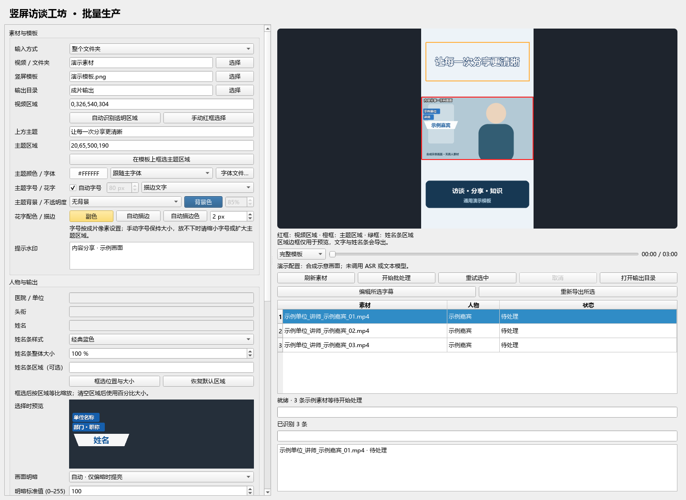
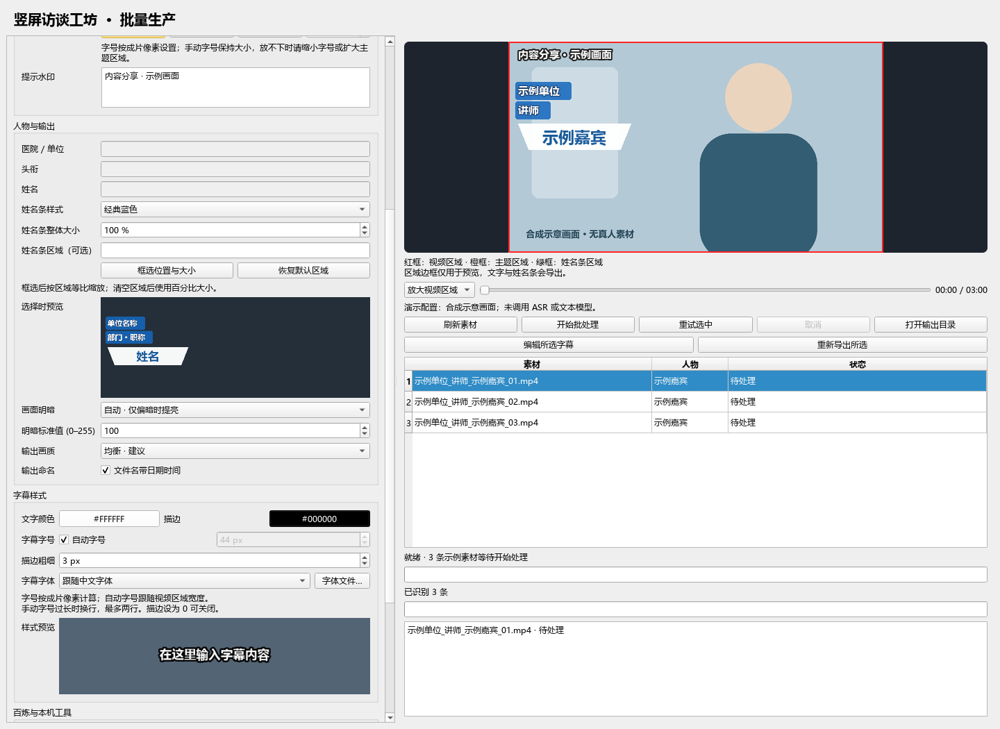
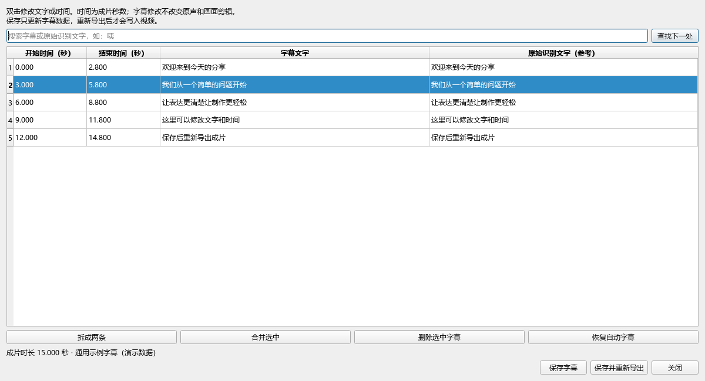
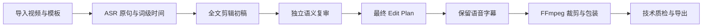

# 竖屏访谈工坊

**批量智能口播粗剪与竖屏包装桌面软件。**

导入一组横屏口播，配置竖屏模板和人物信息，软件自动完成语音识别、语义粗剪、字幕和视频合成。适合访谈、讲解、知识分享等需要统一包装的口播素材，也支持同一人物的多条视频一起处理。

[下载 Windows 版](https://github.com/sleepysnake/vertical-video-studio/releases/latest) · [使用与配置](#开始使用) · [工作流说明](docs/WORKFLOW.md) · [更新记录](CHANGELOG.md)



*实际桌面客户端截图。画面、人物信息和素材均为合成演示数据，列表展示待处理任务；未调用模型，不代表实际剪辑效果。*

## 一次配置，批量制作

素材导入后，任务会逐条自动执行。每条视频的结果、错误和模型疑点保留在工作目录，方便检查或继续处理。

| 能力 | 软件里的操作与结果 |
| --- | --- |
| 批量素材 | 选择整个文件夹；文件名或 CSV 指定人物、视频编号和主题，同一人物可对应多条素材 |
| 语义粗剪 | 模型读取转写全文与词级时间，提出初稿，再独立复审改口、重说、口癖和停顿，生成最终 Edit Plan |
| 字幕制作 | 对实际保留的语音纠错并按语义断句，字幕时间映射到成片时间线 |
| 竖屏包装 | 套用自己的图片模板，设置视频区域、主题、人物信息和提示水印 |
| 失败后继续 | 保留 ASR 与已完成文本阶段，相同配置下可重试未完成阶段 |
| 结果检查 | 查看本次执行计划、疑点、字幕回退和调用记录；技术质检核对音视频流及成片时长 |

正常流程无需处理中途逐处点击确认。模型疑点仍需检查；技术校验通过不能证明剪辑语义完全正确。

## 软件页面里有什么

主界面左侧是素材、模板与样式设置，右侧是视频排版预览、任务操作、素材列表、当前进度和结果详情。

- **素材与模板**：单视频或文件夹输入、输出目录、模板图片、主题与提示水印。
- **区域选择**：透明 PNG 可自动识别视频区；红框支持框内拖动、边缘缩放，主题和姓名条也可指定区域。
- **画面预览**：显示原片视频帧与当前排版，拖动时间滑杆查看不同位置，或放大视频区域检查遮挡。区域提示框不进入成片。
- **任务列表**：查看素材、人物和状态，开始批处理、重试选中、取消任务或打开输出目录。
- **结果详情**：展示本次任务的执行结果、模型疑点和本地记录，便于定位需要检查的素材。

### 人物、字幕与主题样式

姓名条提供七种样式，可调整体大小与位置；字幕可设置字体、颜色、字号和描边。主题支持字体、颜色、字号、描边、阴影、渐变与多种背景。预览和导出共用绘制逻辑，仅调整排版可复用已有剪辑重新导出。



自动明暗会抽样检查原视频，低于设置标准时才提亮；也可手动保持、提亮或压暗。输出提供均衡、高画质、小体积三档，文件名可带日期时间。

<details>
<summary>展开查看七种姓名条样式</summary>


预览使用“单位名称 / 部门·职称 / 姓名”通用文字，实际输出使用素材的人物信息。

</details>

### 生成后还能编辑字幕

选中已生成字幕的素材，点击“编辑所选字幕”，可修改文字和成片起止时间、拆分、合并、删除字幕或恢复自动字幕。“保存”更新字幕数据；“保存并重新导出”将修改写入视频。



*此截图使用通用示例字幕。字幕编辑不改变原声与画面的剪辑；保留原视频和工作目录后，重新导出无需再次调用 ASR 或文本模型。*

## 开始使用

1. 从 [Releases](https://github.com/sleepysnake/vertical-video-studio/releases/latest) 下载 Windows 包，解压到独立目录，运行 `VerticalVideoStudio.exe`。
2. 安装 FFmpeg / FFprobe。软件启动时检测，未找到可查看安装说明，安装后点击“重新检测”或手动选择程序。发布包不包含 FFmpeg。
3. 填入自己的百炼 API Key，选择语音和文本模型。Base URL 只需填写一个，程序生成各阶段请求地址。
4. 导入横屏素材、选择竖屏模板与输出目录，配置人物信息和主题。框选区域并检查排版预览。
5. 点击“开始批处理”。完成后检查结果与疑点；需要时编辑字幕，或修改样式并重新导出。

**运行环境：**Windows、中文字体、FFmpeg / FFprobe、可用的百炼 ASR 和文本 API。独立程序无需安装 Python、Codex、ComfyUI 或本地 Whisper。API 服务产生的费用由使用者自己的账号承担。

API Key 只保留在当前进程，或从 `DASHSCOPE_API_KEY` 环境变量读取。ASR 接收音频，文本模型接收转写与时间索引。软件设置保存在用户配置目录，任务工作文件保存在所选输出目录的 `.vertical-video-studio`，不提交到仓库。

### 同一人物有多条视频

文件名可以用 `单位_职称_姓名_视频编号.mp4`，例如 `示例单位_讲师_示例嘉宾_01.mp4` 与 `示例单位_讲师_示例嘉宾_02.mp4`。

也可在素材文件夹放置 `batch.csv`，使用任意素材文件名并逐条指定信息：

```csv
file,organization,title,name,clip_id,topic,nameplate_style,brightness
clip01.mp4,示例单位,讲师,示例嘉宾,01,表达与分享,classic,auto
clip02.mp4,示例单位,讲师,示例嘉宾,02,第二个话题,classic,auto
```

姓名条字段支持 `classic`、`ass_clean`、`ass_dark`、`broadcast_slant`、`teal_gradient`、`navy_gold`、`light_card`；明暗字段支持 `auto`、`normal`、`bright`、`dark`。没有填写逐条选项时沿用界面设置。

## 从素材到成片



普通预算内视频通常包含初稿、复审、字幕三个逻辑请求，长素材分章和重试会增加实际数量。每条素材的 `model-calls.json` 记录 HTTP 尝试与服务返回的 token 用量；没有返回用量时不估造消耗。详情见 [工作流与执行边界](docs/WORKFLOW.md)。

三个阶段的提示词位于 `config/edit_prompt.txt`、`config/review_prompt.txt`、`config/caption_prompt.txt`。可用文本编辑器调整，下一批读取新配置；界面不提供提示词编辑入口。软件不会自动从复核结果学习。

**当前边界：**测试验证程序结构、源时间映射、缓存恢复和媒体合成，真实模型的剪辑语义与字幕质量仍需检查成片。当前没有持久化调度队列、片段级带声复核播放、黑屏或音量检测。预览是原片帧与排版，不是已剪成片的带声播放。

## 开发与版本管理

项目使用 Python / PySide6，推荐 Python 3.12。应用版本统一维护在 `studio/version.py`；内部分析与缓存版本独立维护。开发使用 Git 分支与提交记录，推送 `v*` 标签后自动运行 Windows 测试、构建、包验证并发布 Release。

```powershell
python -m venv .venv
.\.venv\Scripts\python.exe -m pip install -r requirements.txt
.\.venv\Scripts\python.exe app.py
```

开发测试与打包：

```powershell
.\.venv\Scripts\python.exe -m pip install -r requirements-build.txt
.\.venv\Scripts\python.exe -m unittest discover -s tests -v
powershell -ExecutionPolicy Bypass -File .\build_windows.ps1
```

[参与开发](CONTRIBUTING.md) · [发布流程](docs/RELEASING.md) · [更新记录](CHANGELOG.md) · [MIT 许可证](LICENSE)
