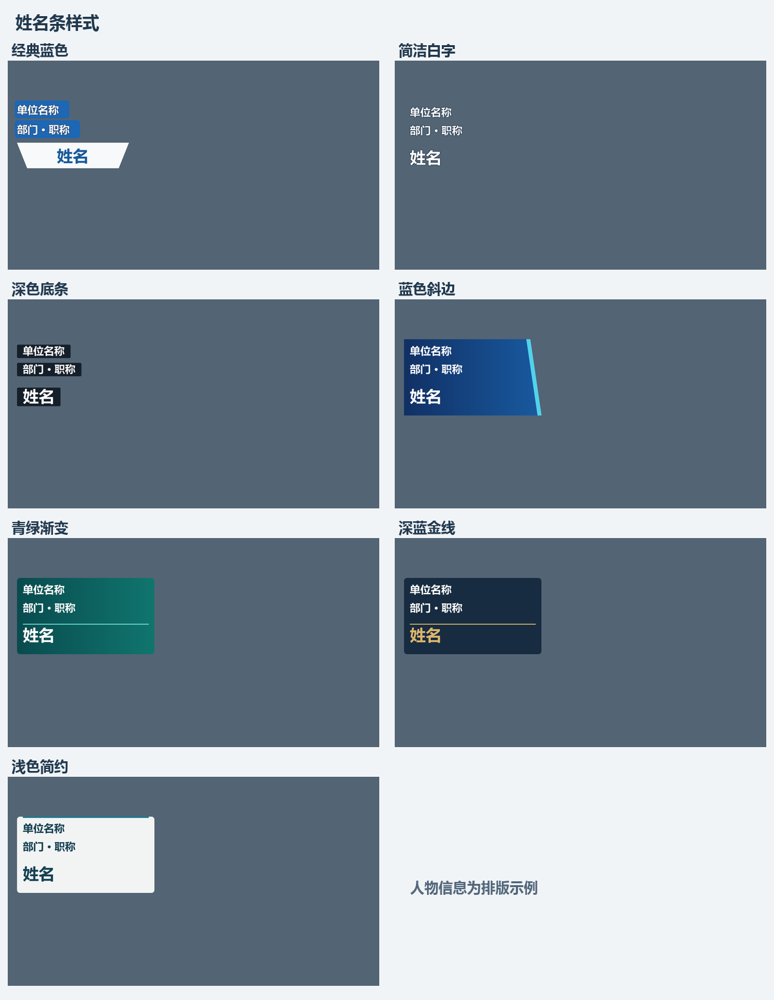

# 竖屏访谈工坊 · Vertical Video Studio

一个基于 Python / PySide6 的 Windows 桌面程序，用于将横屏中文口播批量制作成带模板、字幕和人物信息的竖屏视频。采用 MIT 许可证。

## 能做什么

- 单视频或整个文件夹无人值守处理；同一人物的多条素材可用编号区分。
- 百炼 ASR 词级时间戳，文本模型读取全文生成剪辑初稿、独立语义复审，再为保留语音生成字幕。
- 可检查的 Edit Plan、调用次数及 token 用量记录，ASR 缓存与失败阶段恢复。
- 可选择人名条、字幕样式及主题的字体、颜色、背景；导入素材后预览实际排版。
- 自动识别模板透明视频区；红框支持移动和调整大小。
- 画面明暗检测、可选画质，字幕二次编辑及复用已有剪辑重新导出。



## 使用

从本仓库的 Releases 下载 Windows 包，解压到独立目录运行 `VerticalVideoStudio.exe`。本机需要 FFmpeg / FFprobe；软件启动时检测，未安装可通过安装说明配置后重新检测。发布包不包含 FFmpeg。

填入自己的百炼 API Key，选择横屏视频、竖屏模板、输出目录和人物信息。主题需指定主题区域。透明 PNG 可以自动识别视频位置，不透明模板可手动框选。选择样式后开始处理。

API Key 只保留在当前进程，或从 `DASHSCOPE_API_KEY` 环境变量读取。程序向 ASR 上传音频，向文本模型发送转写内容；使用前确认所选服务适合你的素材。任务记录保存到输出目录的 `.vertical-video-studio`，不含 Key。

批量素材可命名为 `单位_职称_姓名_视频编号.mp4`，也可通过素材目录中的 `batch.csv` 指定信息：

```csv
file,organization,title,name,clip_id,topic,nameplate_style,brightness
clip01.mp4,示例单位,示例职称,示例姓名,01,示例主题,classic,auto
```

`nameplate_style` 支持 `classic`、`ass_clean`、`ass_dark`、`broadcast_slant`、`teal_gradient`、`navy_gold`、`light_card`；`brightness` 支持 `auto`、`normal`、`bright`、`dark`。

## 从源码运行

推荐 Windows 与 Python 3.12，需中文字体与 FFmpeg / FFprobe。

```powershell
python -m venv .venv
.\.venv\Scripts\python.exe -m pip install -r requirements.txt
.\.venv\Scripts\python.exe app.py
```

模型设置和个人路径由程序保存至用户配置目录，不属于仓库。三个阶段的提示词位于 `config/edit_prompt.txt`、`config/review_prompt.txt`、`config/caption_prompt.txt`，可用文本编辑器调整；下一批任务读取新配置，运行中的批次保留配置快照。界面不显示提示词编辑入口。

## 工作流与验证边界

详见 [工作流](docs/WORKFLOW.md)。普通预算内视频通常执行初稿、复审、字幕三次逻辑请求，长素材分章和重试会增加数量；实际用量见 `model-calls.json`。

测试使用模拟 API 返回和真实 FFmpeg 媒体验证。索引、时间和覆盖校验不等于模型语义判断正确；具体素材的剪辑质量需检查成片。当前没有持久化调度队列、片段级带声复核播放、黑屏或音量检测。原片与输出工作目录保留时，字幕手动修改后可以重新导出，无需再次调用模型。

## 开发与版本

应用版本维护在 `studio/version.py`，初始公开版本 `0.1.0`。内部字幕分析及缓存版本独立管理。代码提交到 `main`，功能和修复使用分支与 Pull Request；推送 `v*` 标签后自动测试、构建和发布。

- [参与开发](CONTRIBUTING.md)
- [版本发布](docs/RELEASING.md)
- [更新记录](CHANGELOG.md)
- [MIT 许可证](LICENSE)

```powershell
.\.venv\Scripts\python.exe -m pip install -r requirements-build.txt
.\.venv\Scripts\python.exe -m unittest discover -s tests -v
powershell -ExecutionPolicy Bypass -File .\build_windows.ps1
```
